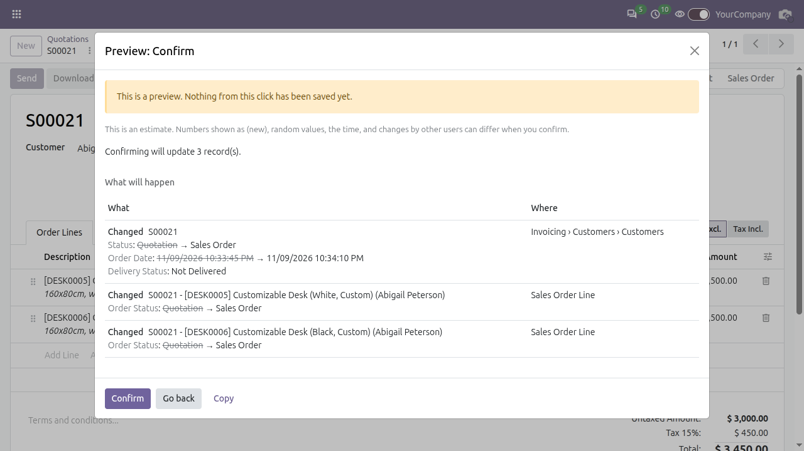
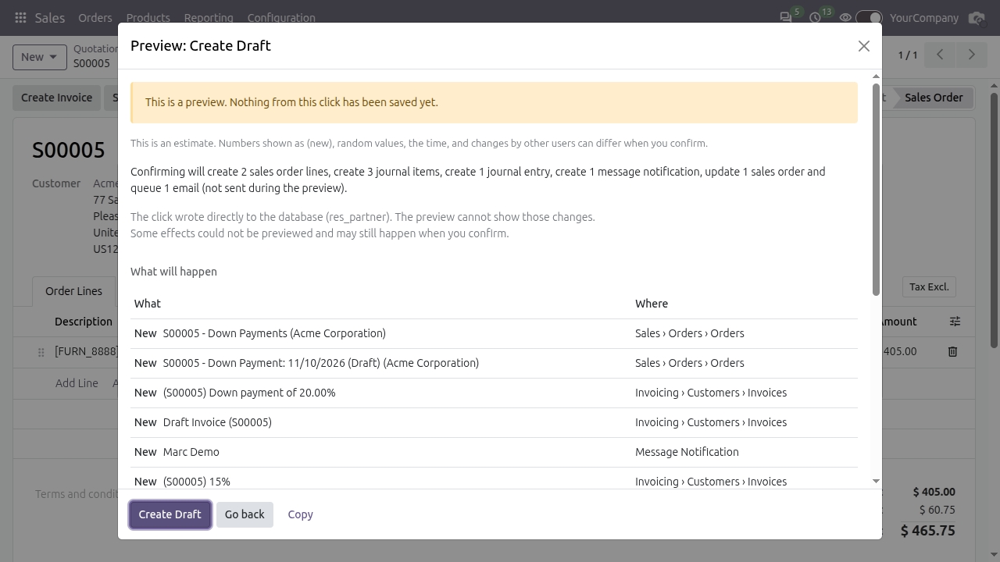

# Preview Mode: user guide

Preview Mode shows what a button would do before it does it. Nothing is saved until you press the confirm button in the popup.

## Turn it on

The eye switch is in the top bar, on every page. Click it to turn previews on, click it again to turn them off. Odoo remembers the choice for your user.

| Off | On |
|---|---|
|  |  |

## Preview a click

Open a quotation with the switch on and click **Confirm**. Instead of confirming, Odoo opens this popup:

From top to bottom:

- The yellow banner says nothing has been saved yet. The grey line under it says the preview is an estimate.
- One sentence summarises the click ("Confirming will create 1 transfer and update 3 records").
- **What will happen** has one row per record. **What** is New, Changed or Deleted; for a changed field the old value is struck through, then the new value. **Where** is the menu path where you will find the record, for example `Sales › Orders › Quotations`.
- If the click creates a journal entry, a Debit/Credit table follows. Emails the click would send are listed as not sent.
- Apps can add their own tables here (see the developer guide).

The footer has three buttons:

- The primary button has the same label as the button you clicked. It runs the click for real.
- **Go back** closes the popup and changes nothing.
- **Copy** puts the preview on your clipboard as plain text.

After a real run, a notification lists the records that were created, each as a link.

Creating an invoice from an order looks the same, with the new invoice and its lines in the list:

## Which clicks open a popup

Only clicks that change data. Smart buttons, report printing and buttons that only open a wizard run as usual. Wizard buttons that change data (for example Create Draft in the Create Invoice wizard) do open a popup.

| Click | Popup |
|---|---|
| Buttons such as Confirm, Validate, Post | Yes |
| List view: Archive, Unarchive, Delete on the selected rows | Yes, after Odoo's own "Are you sure?" |
| Status bar stage click | Yes |
| List Actions menu server actions, kanban drag and drop, Delete from a form's Actions menu | No, they run as usual |
| Installing or upgrading apps, saving Settings, editing models, fields and views | No, they run as usual |

If you edited the form before clicking, Odoo saves your edits first, as it always does. The popup only covers what the button does.

## If the click would fail

The popup says `Confirming will fail: <reason>` in a red banner, for example when a period is locked. The confirm button still works, because the real run is what decides.

## Troubleshooting

**"Preview unavailable" dialog.** The preview request itself failed (network error or a server error). Nothing is known about what the click does. **Run without preview** performs the click as Odoo would without Preview Mode; **Go back** cancels. If it keeps happening, ask your administrator to check the server log.

**"Preview incomplete" or "Some effects could not be previewed".** The click did something a preview cannot reproduce: it opened a separate database connection, rolled back by itself, wrote to the database with raw SQL (the popup names the table), or called an outside service. The listed changes are real, but there may be more when you confirm.

**"The preview timed out after N seconds".** The click spent too long in database statements. Confirming may still work. An administrator can raise `preview_mode.timeout` (1 to 120 seconds, default 10).

**The estimate note.** Numbers shown as `(new)`, random values, the time and changes made by other users can differ when you confirm. The preview is a close estimate, not a promise.

**"A preview is already running."** You can run one preview at a time. The second click ran normally, with no popup.

**"Too many records to preview" or "Preview Mode is switched off by your administrator."** An administrator set `preview_mode.max_records`, or turned Preview Mode off with `preview_mode.enabled`. The click ran normally.

**It feels slow.** The click runs once as a preview and once for real, so heavy buttons take about twice as long. Turn the switch off for bulk work.
